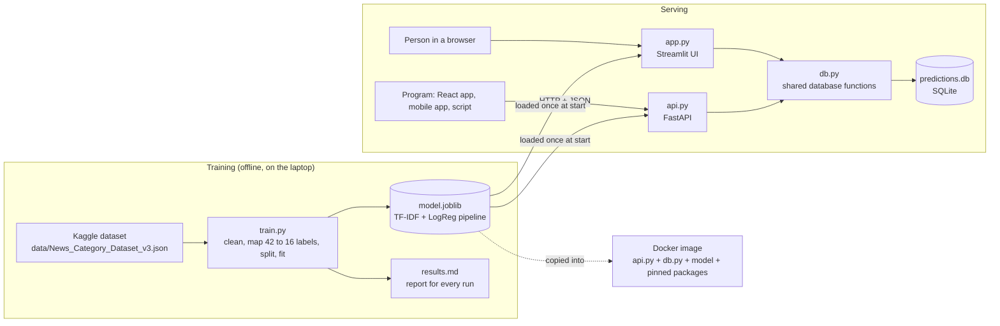
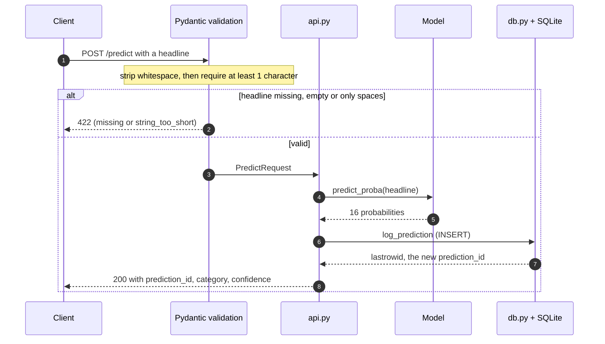
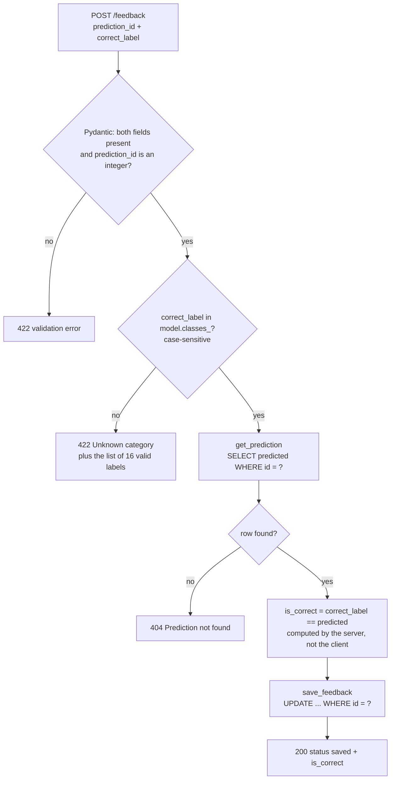

# News Category Classifier

A machine learning project that reads a news headline and predicts the article's category (for example **Politics**, **Sports**, **Business**, **Science & Tech** or **Entertainment**) with a confidence score.

> **Status:** in progress. The data has been explored and cleaned, and a TF-IDF + Logistic Regression model (balanced class weights) is trained and saved. A Streamlit app serves predictions with confidence scores, and predictions and user feedback are logged to SQLite. A FastAPI service exposes `/predict`, `/feedback` and `/health`. Next: Docker, then CI/CD and deployment. The [Build log](#build-log) records each step and the reasoning behind it.

---

## Overview

News sites publish thousands of articles a day. Tagging each one with the right category by hand is slow and inconsistent. This project trains a text classifier that does the tagging automatically.

**Approach**

1. **Baseline:** TF-IDF features + Logistic Regression, in a single scikit-learn `Pipeline`
2. **Later:** a fine-tuned transformer (DistilBERT), compared against the baseline
3. Models are compared on accuracy, **macro-F1** and per-class recall (the classes are imbalanced, so accuracy alone is misleading)

## Dataset

[News Category Dataset v3](https://www.kaggle.com/datasets/rmisra/news-category-dataset): about 210k HuffPost headlines from 2012–2022, labelled with 42 categories.

| Field               | Description                         | Used?                            |
|---------------------|-------------------------------------|----------------------------------|
| `headline`          | Article headline                    | Yes, as the model input (`text`) |
| `short_description` | One-to-two sentence summary         | Not yet (planned)                |
| `category`          | Original label (42 values)          | Mapped to 16 labels (`label`)    |
| `link`, `authors`, `date` | Metadata                      | No                               |

Download the file from Kaggle and put it at `data/News_Category_Dataset_v3.json`. The data is **not** committed to git, because it is about 85 MB.

## Project Structure

```
news-category-classifier/
├── data/                  # downloaded dataset (not committed)
├── explore.py             # Step 1: data exploration
├── train.py               # Steps 2–3: cleaning, split, training, evaluation
├── app.py                 # Step 4: Streamlit UI (prediction, confidence, top 3, feedback)
├── db.py                  # Step 6: SQLite logging of predictions and feedback
├── api.py                 # Step 7: FastAPI service (/predict, /feedback, /health)
├── results.md             # evaluation report for every training run (appended automatically)
├── sample_data.csv        # 50-row toy dataset used for the first prototype
├── Dockerfile             # Step 8: API container image
├── .dockerignore          # keeps venv, data and user data out of the image
├── tests/test_api.py      # Step 8: API tests (pytest + FastAPI TestClient)
├── pytest.ini             # adds the project root to the import path for tests
├── requirements-api.txt   # pinned packages for the API image
├── requirements-dev.txt   # API packages + test tools (used by CI)
├── requirements.txt       # everything for local development
└── README.md
```

`model.joblib` (the saved model) and `predictions.db` (the prediction log) are created at runtime and aren't committed.

## Architecture

### System overview

Training happens once, offline. Serving loads the saved model and logs every prediction.



### `/predict`: request flow, including errors



The database assigns `prediction_id` with `AUTOINCREMENT`, so ids are unique and never reused. Clients never choose them; they receive one as a receipt.

### `/feedback`: decision flow, including errors



The checks run cheapest first: field types (no work), then the label (an in-memory list), then the database lookup. The server can check that a label is **valid**, but not that it is **true**: `{"prediction_id": 8, "correct_label": "SPORTS"}` passes every check even for a tech headline. That is why feedback is reviewed before retraining.

### Status codes

| Code | Meaning | Whose fault | Examples in this project |
|---|---|---|---|
| **200** | OK | – | Successful prediction or feedback |
| **404** | Not found | Caller | `/feedback` with an id that doesn't exist; a path that doesn't exist (e.g. `GET /`) |
| **422** | Request doesn't match the contract | Caller | Missing field, empty or whitespace-only headline, non-integer id, unknown or lowercase label |
| **500** | Internal server error | **Us** | An unhandled exception, e.g. the SQL typo `predcited`. Every 500 is a bug to fix |

### Streamlit path

`app.py` uses the same model and the same `db.py` functions, with one difference: Streamlit re-runs the whole script on every interaction. So it keeps `last_logged` and `row_id` in `st.session_state` to log each headline once and attach feedback to the right row. The API needs no such guard, because each request is a separate, real event.

## Getting Started

```bash
git clone https://github.com/VishRoy/news-category-classifier.git
cd news-category-classifier

python -m venv venv
source venv/bin/activate      # Windows: venv\Scripts\activate

pip install -r requirements.txt
```

Then download the dataset into `data/` (see [Dataset](#dataset)) and run:

```bash
python explore.py   # look at the data
python train.py     # clean, split, train, save model.joblib and append to results.md
streamlit run app.py   # open the web app at http://localhost:8501
uvicorn api:app --reload   # start the API; docs at http://127.0.0.1:8000/docs
```

## Results

Test set: 35,831 headlines (a stratified 20% split), 16 categories, headline text only.

| Model                                          | Accuracy | Macro-F1 | Macro recall |
|------------------------------------------------|----------|----------|--------------|
| TF-IDF + Logistic Regression (baseline)        | 0.72     | 0.63     | 0.59         |
| TF-IDF + Logistic Regression, `class_weight="balanced"` | 0.69 | 0.63 | 0.68         |
| DistilBERT (fine-tuned)                        | –        | –        | –            |

For reference, always predicting the most common class (POLITICS) would score 0.198 accuracy. Full per-class reports for every run are in [results.md](results.md).

---

## Build log

A record of what was done at each step and why.

### Step 1: Explore the data (`explore.py`)

**What:** printed the shape, the column names, the first rows, the count of each category, the null count and the number of duplicate rows.

**Why:** you look at data before you train on it. The category counts reveal class imbalance. Nulls and duplicates have to be fixed before training.

**First attempt: a 50-row toy CSV.** 5 categories × 10 headlines, so perfectly balanced. The full pipeline ran, but test accuracy was **0.20**, which is the same as random guessing with 5 classes. Inspecting the errors showed why: test headlines shared almost no words with the 40 training headlines (vocabulary: 218 words), so the model was matching filler words like *the*, *in* and *with*. **Lesson: TF-IDF can only use words it saw in training, so more data matters more than a fancier model.**

**Switched to the Kaggle dataset** (209,527 rows, 6 columns). Findings:
- **No nulls, but empty strings exist.** `isnull()` doesn't count `""` as missing: 6 headlines are empty and 19,712 `short_description`s are empty.
- **Duplicates depend on what you compare.** Only 13 rows match on *every* column, but many more share the same headline.
- **Heavy imbalance:** POLITICS has 35,602 rows and EDUCATION has 1,014.
- **Messy labels:** renamed categories (`WORLDPOST` / `THE WORLDPOST`), overlapping topics (`WELLNESS` / `HEALTHY LIVING`) and labels that describe the audience rather than the topic (`BLACK VOICES`, `WOMEN`).

### Step 2: Clean the data and split it (`train.py`)

**Label design: 42 categories mapped to 16.** Users can type a headline on any topic, so we kept broad coverage rather than just 5 categories. But we also cleaned up the label set:
- **Merged** renamed or overlapping labels (e.g. `WORLD NEWS` + `WORLDPOST` + `THE WORLDPOST` → `WORLD`, `TECH` + `SCIENCE` → `SCIENCE & TECH`).
- **Dropped** labels that aren't topics: audience labels (`BLACK VOICES`, `QUEER VOICES`, `LATINO VOICES`, `WOMEN`, `FIFTY`), tone labels (`IMPACT`, `GOOD NEWS`, `WEIRD NEWS`) and vague ones (`U.S. NEWS`, `MEDIA`). They aren't put in an "OTHER" category, because such a category would have no consistent vocabulary to learn from.
- **Kept** ARTS separate from ENTERTAINMENT (galleries and books use different words from celebrity news), and kept RELIGION.
- The mapping is written as `new label → [old labels]` (easy to read) and flipped into an `old → new` lookup with a dict comprehension. The original `category` column is kept for debugging.

**A single `text` column.** The model only ever reads `text`. Today it is the headline. Later it becomes headline + description, which means changing one line, with no changes to the pipeline or the app.

**Cleaning order:** map labels → build `text` (with whitespace stripped) → drop empty texts → drop duplicates.
- **Duplicates are defined by `text` only**, because that's all the model sees. Two rows with the same headline but different links are the same "flashcard" to the model. If one lands in train and the other in test, the test score is inflated. A few headlines appeared with *conflicting* labels, a sign that real labels contain human disagreement.
- No manual lowercasing or punctuation removal: `TfidfVectorizer` does this itself, so training and the app process text the same way.
- Result: 180,514 → **179,153 rows** (1,361 removed). LIFESTYLE lost the most (608), mostly recurring column titles.

**Stratified 80/20 split** (`stratify=y`, `random_state=42`): 143,322 train / 35,831 test. Stratifying keeps the same category proportions in both sets, so small classes such as EDUCATION (1.2% of the data, 432 test rows) are fairly represented. A fixed `random_state` makes runs reproducible, so you can tell whether a change actually helped.

### Step 3: Train and evaluate

**Why no NLTK:** `TfidfVectorizer` already tokenizes and lowercases, and TF-IDF gives very common words (*the, in, of*) a low IDF weight, so stop-word removal adds little. The only NLTK feature likely to help is stemming or lemmatization (`elections` → `election`). It wasn't used, to keep the baseline simple, and because any preprocessing must live *inside* the Pipeline, otherwise `api.py` and `train.py` would see different text. It's a candidate experiment.

**Why Logistic Regression over Naive Bayes:** Naive Bayes is *generative*. It counts how likely each word is in each class and assumes words are independent. That makes training very fast and works well on small data, but correlated words ("New" + "York") get counted twice, which pushes probabilities to extremes. Logistic Regression is *discriminative*: it learns all the word weights jointly to separate the classes, which usually wins with large data (143k training headlines here) and gives more sensible probabilities, which the app's confidence display relies on. Candidate experiment: swap in `ComplementNB` (a Naive Bayes variant designed for imbalanced text) and compare macro-F1 in `results.md`.

**Pipeline:** `TfidfVectorizer()` → `LogisticRegression(max_iter=1000)`. Bundling them means the exact same text processing runs during training and prediction, and the vocabulary is learned from the training data only. Vocabulary: **48,691 words**.

**Baseline result:** accuracy 0.72, macro recall 0.59.
- The gap between the two shows the model does well on the big classes and poorly on the small ones. Accuracy weights every *row* equally, while macro averages weight every *class* equally.
- Small classes have **high precision but low recall** (EDUCATION 0.59 / 0.31, RELIGION 0.69 / 0.35, ARTS 0.66 / 0.37). The model rarely predicts them and misses most of them.
- Big classes act as catch-alls (POLITICS recall 0.86, WELLNESS 0.81).

**Experiment log.** Each run of `train.py` appends its classification report to `results.md`, with a timestamp, a short note and the classifier's settings. The file is opened in append mode, so earlier runs are never overwritten.

**Experiment 1: `class_weight="balanced"`.** Mistakes on rare classes cost more during training, in inverse proportion to class size. Only this one setting changed, so the comparison with the baseline is fair.

| | Baseline | Balanced |
|---|---|---|
| Accuracy | 0.72 | 0.69 |
| Macro recall | 0.59 | **0.68** |
| Macro precision | **0.70** | 0.60 |
| Macro-F1 | 0.63 | 0.63 |
| EDUCATION recall | 0.31 | **0.62** |
| RELIGION recall | 0.35 | **0.65** |
| POLITICS recall | **0.86** | 0.70 |

- Small classes roughly **doubled their recall**, at the cost of lower precision. The model now predicts them more often and gets more of them wrong.
- Big classes lost recall but gained precision (POLITICS precision 0.76 → 0.89). They are no longer catch-alls.
- **Macro-F1 didn't change.** The model didn't learn anything new; it moved the trade-off between precision and recall. Better *knowledge* would have to come from better input: more context (e.g. `short_description`), word pairs (bigrams) or a stronger model.

**Decision: keep the balanced model.** Every category should get a fair chance, because the app is meant to handle news on any topic. Giving up 3 points of accuracy is worth it, compared with a model that rarely predicts small topics such as EDUCATION or RELIGION.

**Saving the model.** `joblib.dump(model, "model.joblib")` saves the whole Pipeline (TF-IDF vocabulary + classifier weights) as one 6.9 MB file. The app loads it instead of retraining. Saving both parts together means the classifier can never be paired with the wrong vocabulary. Check: loaded in a fresh Python process, the model predicted `SPORTS` for "Lakers beat Celtics in overtime thriller". The file isn't committed, because `python train.py` can regenerate it. When loading, the scikit-learn version must match the one used for saving, so the version will be pinned before deployment.

### Checkpoint: `.gitignore` and first commit

Committed once Steps 1–3 worked, before starting the app, so there is a known-good state to return to. `.gitignore` excludes `venv/` (520 MB, recreated with `pip install -r requirements.txt`), `data/` (83 MB, downloaded from Kaggle), `model.joblib` (regenerated by `train.py`), `__pycache__/` and `.DS_Store`. Files were added by name, not with `git add .`, and `git status` was checked before committing.

### Step 4: Streamlit app (`app.py`)

**What:** a text box for a headline. The app shows the predicted category, a confidence percentage with a progress bar, a warning below 50% confidence, and the top 3 categories.

**How:**
- The model is loaded once with `@st.cache_resource`. Streamlit re-runs the whole script on every interaction, so without caching the 6.9 MB model would be reloaded on every interaction (each submitted headline, each button click).
- `predict_proba` returns all 16 probabilities. `argmax` picks the winner, and `model.classes_` maps positions to category names. `argsort()[::-1][:3]` gives the top 3.

**What testing showed:**

| Headline | Prediction | Runner-up |
|---|---|---|
| Lakers beat Celtics in overtime thriller | SPORTS 59% | ENTERTAINMENT 4% |
| Apple stock has increased after iPhone launch | SCIENCE & TECH 99% | BUSINESS 0.3% |
| Durga Puja celebration has started in India | WORLD 52% | – |
| Rumor is Angelina Jolie is going to marry again | ENTERTAINMENT 35% ⚠️ | FAMILY 15% |

- **Confident doesn't mean correct.** The Apple headline is really both tech and business, yet the model says 99% tech. Per-word contributions showed why: "apple", "iphone" and "launch" voted strongly for SCIENCE & TECH (≈ +6.8 together), and only "stock" leaned towards BUSINESS (+0.7). Softmax turns that score gap into ≈ 400× odds. **Confidence measures how consistent the training data was, not how ambiguous the headline really is.** The warning can only catch cases where the model itself is torn.
- **Bias from the dataset:** the data is US-centric (HuffPost), so headlines mentioning another country (e.g. "India") lean towards WORLD, regardless of their actual topic.
- **The top 3 list makes uncertainty visible**, e.g. ENTERTAINMENT vs FAMILY for a celebrity wedding.

### Step 6: Log predictions to SQLite (`db.py`)

**Why:** to see what real users type, how the model performs on it, and to collect corrections that can later become training data (a feedback loop).

**Table `predictions`:**

| Column | Purpose |
|---|---|
| `id` | Auto-incrementing key, used to attach feedback to the right row |
| `created_at` | ISO timestamp (sorts correctly as text) |
| `headline`, `predicted`, `confidence` | What was asked and what the model answered |
| `model_version` | Which model answered, so v1 and v2 can be compared on real traffic |
| `is_correct`, `correct_label` | User feedback; empty (NULL) until given |

**Design choices:**
- The database code lives in its own module, so the FastAPI service can reuse it.
- `?` placeholders are used in every query, so user input is stored as data and never run as SQL (prevents SQL injection).
- Streamlit re-runs the script on every interaction, so `st.session_state` remembers the last logged headline. Otherwise each rerun would log the same prediction again.
- `predictions.db` is git-ignored, because it contains what users typed.

**First real log rows** showed typical messy user input: a partly typed headline (`Iphone launc`) was submitted, and still got 98% SCIENCE & TECH from the single word "iphone". User-submitted text and labels need review before they are used for retraining.

**Feedback form.** Below each prediction there is a dropdown preselected with the model's answer, plus a Submit button. If the prediction is right, the user just submits. If it's wrong, they pick the right category first. `is_correct` is inferred as `correct_label == prediction`, and `save_feedback` runs `UPDATE ... WHERE id = ?` on the logged row.
- The dropdown's `key` includes the row id, so it resets for every new headline.
- `st.button` is True only on the rerun triggered by the click, so feedback is saved once per click.
- The feedback code runs *after* logging, so `row_id` always belongs to the current headline.
- Known limitation: a user who submits without reading the dropdown records "correct" even when it isn't.

Verified: "Apple stock has increased after iPhone launch" was stored as `is_correct = 0`, `correct_label = BUSINESS`, and "New Iphone 18 has been launched" as `is_correct = 1`.

### Step 7: FastAPI service (`api.py`)

**Why an API as well as Streamlit:** Streamlit is a UI for humans. An API lets *programs* get predictions over HTTP + JSON: a React frontend, a mobile app or another service, in any language. The model still runs on the server; clients only ever receive predictions. It also separates the UI from the model, so each can change or scale on its own.

**Endpoints:**

| Method | Path | Purpose |
|---|---|---|
| `POST` | `/predict` | Body `{"headline": "..."}` → `{"category": ..., "confidence": ...}` |
| `POST` | `/feedback` | Body `{"prediction_id": 8, "correct_label": "BUSINESS"}` → `{"status": "saved", "is_correct": false}` |
| `GET` | `/health` | `{"status": "ok", "model_loaded": true}`, for Docker and Cloud Run health checks |
| `GET` | `/docs` | Interactive documentation, generated automatically by FastAPI |

**Design choices:**
- The model is loaded once at server start (module level). FastAPI doesn't re-run the file per request, unlike Streamlit.
- **Pydantic request/response models** act as a contract. Invalid requests are rejected with **422** before the model runs: a missing field gives `missing`, and an empty headline gives `string_too_short`.
- `POST`, not `GET`, for `/predict`, because the headline is sent in the request body rather than the URL.
- **Bug found and fixed:** a headline of only spaces (`"   "`) passed `min_length=1` and returned `200 WELLNESS 9%`. That's a meaningless answer: zero words, so the prediction comes only from the model's intercepts. Fixed with `ConfigDict(str_strip_whitespace=True)`, so whitespace is stripped before validation and the request gets 422.
- Consistency check: the API and the Streamlit app both return SPORTS at 59.35% for the same headline, which confirms they share one model file (logistic regression is deterministic).

**Logging.** `/predict` reuses `log_prediction` from `db.py`, so API and Streamlit predictions go into the same `predictions` table. The response includes a `prediction_id` (the row id), a receipt number that a client can use to send feedback later.
- Unlike Streamlit, the API logs **every** request, including the same headline sent twice. Each API call is a separate, deliberate event; Streamlit's duplicates were side effects of reruns, not real user actions. **Rule: one log row per real event.**
- Known issue: `MODEL_VERSION` is defined in both `app.py` and `api.py`. It should live in one place before the first retrain, so logged versions can't drift apart.

**Feedback endpoint.** `/feedback` lets any client correct a prediction using its `prediction_id`. Validation:

| Bad input | Response | Why |
|---|---|---|
| Unknown label (`"SPORT"`, `"TECH"`, `"banana"`) | **422**, with the list of valid categories | Junk labels would create new categories at retraining and undo the 42 → 16 label design. The model's `classes_` is the single source of truth. |
| `prediction_id` that doesn't exist | **404** "Prediction not found" | Otherwise `UPDATE ... WHERE id = ?` would silently change 0 rows, and the client would think it worked |
| `prediction_id` that isn't a number | **422** (automatic, from the `int` type hint) | |

- `is_correct` is **computed by the server** (the stored prediction compared with the label), never sent by the client. Don't trust the client with anything the server can work out.
- Cheap checks come first (the label, in memory), then the database lookup.
- **Bug found:** a typo inside a SQL string (`predcited`) caused a **500**. Python doesn't check SQL text, so this kind of error only shows up when the query runs. This is a strong argument for automated tests that call every endpoint (Step 8).

Run it with `uvicorn api:app --reload` and open http://127.0.0.1:8000/docs.

### Step 8: Docker, then hosting (planned)

**Why Docker comes before hosting:** a host such as Render or Cloud Run starts the API on a fresh, empty machine. That machine has no Python 3.13, no venv, no installed packages (or the exact versions we used), and no `model.joblib`, which is git-ignored and therefore not on GitHub. A Docker image packages all of this (OS base, Python, pinned packages, code, model) into one unit that runs the same on any machine. Packing comes before moving house.

**Hosting choice: Google Cloud (GCP), with Cloud Run.** A major cloud provider was preferred over Render for real-world relevance. Cloud Run runs a container image directly, scales to zero when idle, and fits with Artifact Registry (images) and Cloud Storage (model files) on the same platform.

Order: **Docker image → test the container locally → push to a registry → host it (public URL) → CI/CD to automate it all.** Hosting without Docker is possible on some platforms (Render can run Python directly), but the missing model and version pinning would still have to be solved, Cloud Run requires a container, and an image lets us switch hosts without changes.

**Why write tests when we already have Docker and SQLite:** they do different jobs. Docker *packages* the code, SQLite *stores* the data, and tests *check that the code behaves correctly*. Docker packages a bug just as faithfully as working code: the `predcited` SQL typo would have built into a perfectly good image and returned 500 to every `/feedback` caller. Tests also protect future changes, e.g. when `db.py` moves to Postgres, the same tests show that `/predict` and `/feedback` still behave as before. CI runs them on every push, so nobody has to remember to.

**Step 8-CI-a: tests (`tests/test_api.py`).** Run them with `python -m pytest -v`. Using `python -m` guarantees that pytest comes from the active venv; plain `pytest` once picked up the system Python's pytest, which has no fastapi.

- **No real model needed.** A session-scoped fixture trains a tiny 6-headline model in a temporary folder and points the app at it through the `MODEL_PATH` environment variable (`api.py` falls back to `model.joblib` when it isn't set). It also points `db.DB_PATH` at a temporary database, so tests never touch the real `predictions.db`. `import api` happens *inside* the fixture, because `api.py` loads the model and creates the table at import time.
- **Tests check the contract, not accuracy:** status codes, response fields, and types. Model quality is measured by `train.py` and `results.md`.

| Test | Checks |
|---|---|
| `test_health` | 200 and `model_loaded: true` |
| `test_predict_returns_valid_response` | Known category, confidence between 0 and 1, integer `prediction_id` |
| `test_predict_rejects_bad_input` (×3, parametrized) | 422 for `""`, `"   "` and a wrong field name |
| `test_feedback_rejects_unknown_label` | 422, and the message lists the valid labels |
| `test_feedback_unknown_prediction_id` | 404 for a missing id |
| `test_predict_then_feedback` | Full loop with a real id; `is_correct` computed correctly both ways |

**Checking that the tests can fail:** reintroducing the old `predcited` SQL typo made exactly the 2 tests that reach `get_prediction` fail with `no such column: predcited`. The unknown-label test still passed, because the label check stops the request before the database is queried (cheap checks first). A test that can never fail protects nothing.

| Requirements file | Contents | Used by |
|---|---|---|
| `requirements-api.txt` | API packages | Docker image |
| `requirements-dev.txt` | `-r requirements-api.txt` + pytest, httpx | CI |
| `requirements.txt` | `-r requirements-dev.txt` + pandas, streamlit | Laptop |

**Why CI/CD builds the image automatically (later in Step 8):** so that what runs in production is exactly what's in git, never "whatever was on my laptop, including uncommitted changes". Every change is tested and built the same way, broken code or a broken Dockerfile is caught before it reaches users, and each image is tagged with its commit, so any deployed version can be traced or rolled back. Usual setup: run tests on every push or pull request; build and deploy only when changes are merged into `main`.

**What goes inside the image**, found by reading `api.py` line by line: Python 3.13, pinned packages, the code (`api.py`, `db.py`), the model (`model.joblib`), the start command (`uvicorn ...`) and a port.

**Step 8a: pin exact versions.** Without `==`, Docker installs whatever is newest on build day, which could be a scikit-learn or numpy version that can't load `model.joblib`. Versions were taken from `pip freeze` in the venv the model was trained with (Python 3.13.12). numpy and scipy are pinned too: they aren't imported directly, but the saved model depends on them.

Two files, so the API image stays small and each version is written once:

| File | Contents | Used by |
|---|---|---|
| `requirements-api.txt` | fastapi, uvicorn, pydantic, joblib, scikit-learn, scipy, numpy | The Docker image |
| `requirements.txt` | `-r requirements-api.txt` + pandas, streamlit | Local development (training, UI) |

Streamlit and pandas are left out of the API image because the API doesn't use them, and Streamlit alone pulls in hundreds of MB of dependencies. A smaller image means faster builds, deploys and cold starts, and less third-party code to patch.

**Step 8b: Dockerfile.** Each line maps to one ingredient:

```dockerfile
FROM python:3.13.12-slim                 # OS + the exact Python version used for training
WORKDIR /app
COPY requirements-api.txt .
RUN pip install --no-cache-dir -r requirements-api.txt   # pinned packages
COPY api.py db.py model.joblib ./        # code + model
EXPOSE 8000                              # port
CMD ["uvicorn", "api:app", "--host", "0.0.0.0", "--port", "8000"]   # start command
```

- **Layer order matters.** Requirements are copied and installed *before* the code. Docker caches each layer, so editing `api.py` only rebuilds the last `COPY`, and the slow `pip install` layer is reused.
- **`--host 0.0.0.0`**: inside a container, `127.0.0.1` only accepts connections from the container itself, so requests from the laptop would be refused.
- **`.dockerignore`** keeps `venv/` (520 MB), `data/` (83 MB), `predictions.db` (user data), `__pycache__/` and `.git/` out of the build context.

Build and run:

```bash
docker build -t news-classifier-api .
docker run -p 8000:8000 news-classifier-api   # -p laptop_port:container_port
```

**Verified:** image size 449 MB; `/health` returns `{"status":"ok","model_loaded":true}`; `/predict` returns SPORTS at 0.5935 for the Lakers headline, identical to the local run, which confirms the same model and package versions. The first prediction in the container got `prediction_id: 1`: the container starts with its own empty `predictions.db`, not the laptop's. This shows the "SQLite is wiped on cloud hosts" issue in practice.

---

## Known issues and decisions to revisit

Problems we know about but have deliberately postponed, with the reason and the planned fix, so nothing is forgotten.

| Issue | Why it matters | Planned fix | When |
|---|---|---|---|
| **SQLite file is wiped on cloud hosts** | Cloud Run and similar hosts use temporary disks. When the container restarts, scales or redeploys, `predictions.db` and all logged predictions and feedback disappear without warning (like leaving things in a hotel room at checkout). | Move logging to a managed database outside the container (e.g. Postgres). Only `db.py` needs to change, because all database code lives there. | At deployment (Step 8) |
| ~~**scikit-learn version must match**~~ ✅ fixed | A model saved with one scikit-learn version may fail to load, or behave differently, under another. | Direct dependencies pinned with `==` in `requirements-api.txt` (Step 8a). | Done |
| **Indirect dependencies aren't pinned** | Packages our packages depend on (e.g. starlette, pydantic-core) are only constrained with `>=`, so a future build could still pull different versions. | Generate a full lock file (e.g. `pip freeze` in the container, or a tool like pip-tools or uv) and install from it. | Before production deployment |
| ~~**`model.joblib` isn't in git**~~ ✅ fixed | A fresh machine or host has no model file, so `api.py` would fail on startup. | The model is copied into the Docker image (Step 8b). CI will need a way to get or rebuild it, because it isn't in the repo. | Done (CI follow-up in Step 8) |
| **CI can't build the real image** | The Dockerfile copies `model.joblib`, which isn't in git, so `docker build` on GitHub's machine fails with "not found". (Tests avoid this by training a tiny model.) | Store trained models outside git, e.g. a Google Cloud Storage bucket, with CI downloading the right version before `docker build`. | CI job 2 (Step 8) |
| **Image is built for ARM (Apple Silicon)** | The laptop is `arm64`, but cloud servers run `amd64`. An ARM image fails on Cloud Run with `exec format error`. | Build with `docker build --platform linux/amd64` (or build in CI, which runs on amd64). | Before the first deploy |
| **Container runs as root** | The API process runs as the `root` user inside the container. If an attacker exploits a bug in the API, they get full control of the container. | Add a non-root user in the Dockerfile (`RUN useradd ...` + `USER appuser`). | Before production deployment |
| **`MODEL_VERSION` is defined twice** (`app.py` and `api.py`) | After a retrain, updating one and forgetting the other makes logged versions wrong and breaks v1-vs-v2 comparisons. | Move it to one shared place (e.g. a `config.py`). | Before the first retrain |
| **Feedback can be careless or malicious** | Users can submit without reading the dropdown, or send deliberately wrong labels through `/feedback`. | Review feedback before retraining; ship a new model only if it beats the current one on a fixed test set. | Retraining step |
| **Confidence ≠ correctness** | Strong words (e.g. "apple", "iphone") can produce 99% confidence on headlines that really belong to two categories. | Show the top 3 (done); later compare with DistilBERT and consider probability calibration. | Model improvement |
| **US-centric training data** | Headlines mentioning other countries lean towards WORLD regardless of topic. | Monitor live accuracy by region; add non-US training data. | After launch |

---

## Interview prep

Questions an interviewer might ask about this project, with model answers based on what was actually built. Click a question to see its answer. A good answer follows the pattern **what I saw → what I checked → what I concluded → what I did**, with at least one real number or example.

### Data and labels

<details>
<summary><b>Q1. You started with 50 rows and got 20% accuracy. How did you work out it was the data and not a bug in your code?</b></summary>

"Accuracy was 0.20, which with 5 balanced classes is exactly random chance, so I suspected the model wasn't learning anything rather than learning the wrong thing. I printed each test headline with its prediction and checked which of its words were in the vocabulary. Almost none were. The vocabulary was only 218 words, so most test headlines matched only filler words like 'the' and 'with'. The confidence on every prediction was about 0.25, barely above the 0.20 of a uniform guess. So the code was fine; 40 training rows just couldn't cover the vocabulary. I switched to a 200k-row dataset and accuracy went to 72%."

*Key points: compare with a baseline (random chance), show evidence (vocabulary size, matched words, confidence), and a fix that confirmed the diagnosis. The toy data was perfectly balanced, so imbalance was not the cause.*
</details>

<details>
<summary><b>Q2. The dataset had 42 categories. How did you decide on 16, and why not put the unclear ones into an "OTHER" class?</b></summary>

"I grouped the 42 labels by what the headline is *about*, since that's all the model sees. Three kinds of fixes: merging renamed labels, like WORLDPOST and THE WORLDPOST; merging overlapping topics, like TECH and SCIENCE; and dropping labels that describe the *audience* or *tone* rather than the topic, like BLACK VOICES or WEIRD NEWS, because a politics story could carry any of them. I didn't create an OTHER class because its headlines would share no vocabulary, so the model couldn't learn what makes something 'other'. I also made judgement calls, like keeping ARTS separate from ENTERTAINMENT because gallery and theatre headlines use different words from celebrity news."

*Key points: the unclear labels were dropped, not kept. Explain why OTHER fails (no shared vocabulary).*
</details>

<details>
<summary><b>Q3. What is data leakage? Give two concrete places in your project where it could have happened.</b></summary>

"Data leakage is when information from the test set, or from the future, gets into training, so the evaluation is better than real performance. In my project there were two risks. First, the TF-IDF vectorizer: if I'd fit it on the full dataset, the vocabulary and the IDF weights would include the test headlines. I prevented that by putting it in a Pipeline that's fit only on the training split. Second, duplicates: the dataset had more than 1,300 repeated headlines. If one copy lands in train and another in test, the model is tested on something it memorised. So I deduplicated on the text column, the only thing the model sees, before splitting."
</details>

### Model and evaluation

<details>
<summary><b>Q4. Your baseline had 72% accuracy, but you shipped the 69% model. Defend that to a product manager who only cares about accuracy.</b></summary>

"Accuracy hid a problem. The baseline scored 72%, but it rarely predicted small categories: it caught only 31% of education headlines and 35% of religion ones, because it leaned towards the big classes. With balanced class weights, accuracy dropped 3 points, but recall on those small categories roughly doubled, and the macro-F1 (the average quality across all categories) stayed the same at 0.63. So we didn't lose quality; we spread it more fairly. For an app where users type news on any topic, a model that ignores six categories is a worse product than one that's 3 points lower overall."

*Key points: with 16 classes, always predicting POLITICS scores only 19.8%, so the real problem was low recall on small classes. Macro-F1 unchanged means errors were traded, not added. Frame it around users.*
</details>

<details>
<summary><b>Q5. Explain precision vs. recall using one category from your project.</b></summary>

"Take EDUCATION in my baseline model. Precision was 0.59: when the model said 'education', it was right 59% of the time. Recall was 0.31: of all the real education headlines in the test set, it found only 31%; the rest were mostly labelled as politics. So the model was cautious: when it predicted education it was usually right, but it rarely did. After balancing the class weights, recall went up to 0.62 and precision went down to 0.31. That's the typical trade-off: predict a class more often, and you catch more of it but you're wrong more often."

*Memory trick: precision looks at your **net** (how much of what you caught is right?), recall looks at the **lake** (how many of the real ones did you catch?). Both are per category.*
</details>

<details>
<summary><b>Q6. Why use a scikit-learn Pipeline instead of fitting the vectorizer and the classifier separately?</b></summary>

"The Pipeline bundles TF-IDF and Logistic Regression into a single object. That gives me three guarantees. First, calling `fit` on the training split fits the vectorizer only on training data, so the test vocabulary can't leak in. Second, `predict` in my Streamlit app automatically applies exactly the same text processing as in training. Third, I save one `model.joblib` file, so the vocabulary and the classifier weights can never get out of sync. Without it, I could accidentally fit the vectorizer on all the data, or deploy a new vectorizer with an old classifier; the code would run, but the predictions would be wrong."
</details>

### Product and engineering

<details>
<summary><b>Q7. A headline clearly about both business and tech got 99% TECH. Why, and what does that say about confidence scores?</b></summary>

"I looked at how much each word contributed. 'Apple', 'iPhone' and 'launch' voted strongly for TECH (about +6.8 together), because in the training data those words almost always appeared in tech headlines. Only 'stock' leaned towards business, at +0.7. Softmax turns that score gap into roughly 400-to-1 odds, so 99%. The lesson is that confidence measures how consistent the training data was for these words, not whether the answer is right or whether the headline is ambiguous. So in the app I show the top 3 categories and a low-confidence warning, and I treat confidence as a hint, not a guarantee."

*Key points: the cause is learned word weights, not words repeating in the headline. Softmax amplifies score gaps.*
</details>

<details>
<summary><b>Q8. You log user feedback. Why not retrain on it automatically every night?</b></summary>

"Three reasons. First, label quality: feedback can be careless (people clicking Submit without reading) or even malicious, and the model would learn those mistakes. Second, bias: the people who give feedback, and the headlines they correct, aren't representative of all traffic. Third, and most important, there's no safety check. A new model should be evaluated on a fixed held-out test set and compared with the current one before deployment. That's why I log `model_version`: so I can compare v1 and v2 on real traffic. So feedback goes into a review queue, gets checked, is merged with the original training data, and the retrained model only ships if it beats the current one."

*Keyword: MLOps (monitoring, retraining pipelines, evaluation gates). Typos are realistic input; the bigger risks are bad labels and shipping without comparison.*
</details>

<details>
<summary><b>Q9. Streamlit reruns the whole script on every click. What problems did that cause, and how did you solve them?</b></summary>

"Streamlit re-executes the whole script on every interaction, which caused three problems. One: the model would reload from disk each time, so I cached it with `st.cache_resource`. Two: every rerun would log the same prediction again, because the headline is still in the text box, so I stored the last logged headline in `session_state` and only insert when it changes. Three: the feedback form had to update the right database row, so I keep the row id in `session_state`, give the dropdown a key per row so it resets for each new headline, and rely on `st.button` returning True only on the click's own rerun. I even hit an indentation bug where a heading only appeared on the first run, which is a typical rerun issue."
</details>

### Not yet practised

- **Q10.** If you had one week to improve macro-F1 above 0.63, what would you try first, and how would you know whether it worked?
- **Q11.** Your training data comes from a US news site. You're launching in India. What problems do you expect, and how would you detect them after launch?

---

## Roadmap

- [x] Explore the data
- [x] Clean the text and merge overlapping categories
- [x] Train and evaluate a TF-IDF baseline
- [x] Handle class imbalance and save the model (`model.joblib`)
- [x] `.gitignore` (venv, data, model) and commit
- [x] Streamlit app with a confidence score, a "not sure" warning below 50% and the top 3 categories
- [x] Log predictions and user feedback to SQLite
- [x] FastAPI service: `/predict`, `/feedback`, `/health`
- [ ] Dockerfile, CI/CD (GitHub Actions) and deployment
- [ ] Add `short_description` to the input text
- [ ] React frontend; fine-tune DistilBERT and compare it with the baseline

## License

_TODO: choose a license (e.g. MIT) and add a `LICENSE` file._
